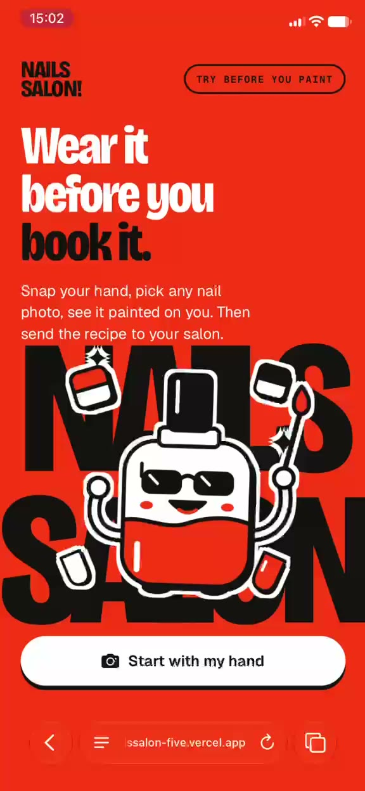
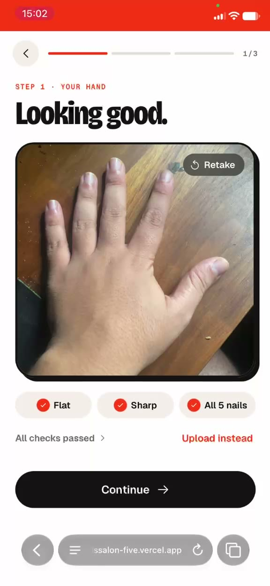
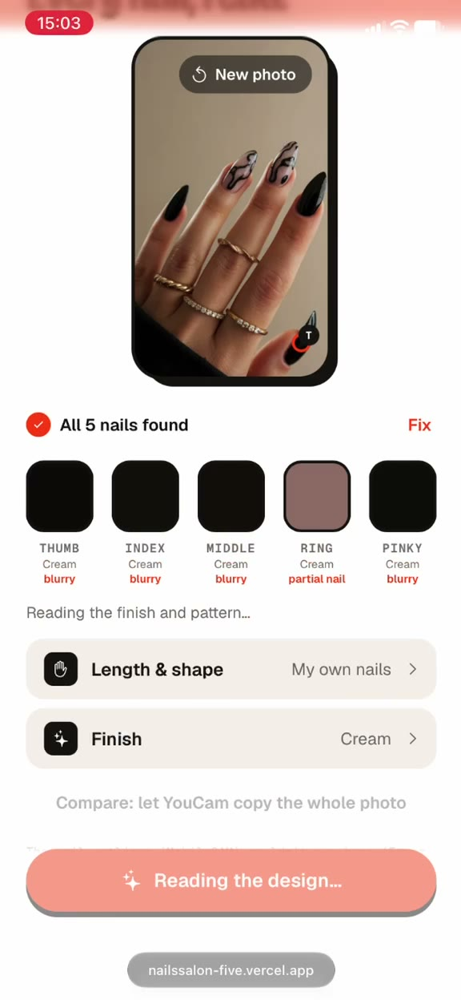
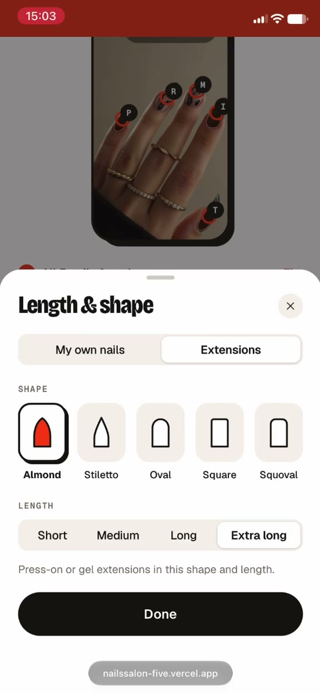
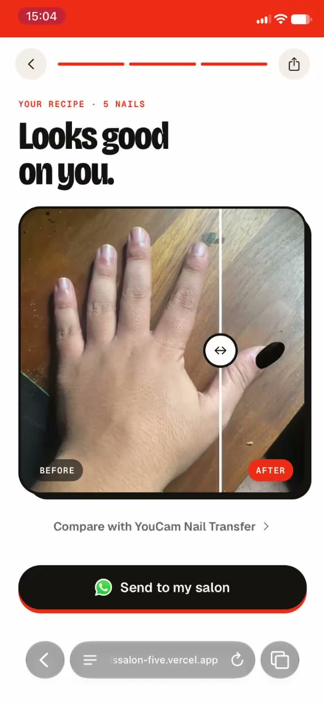
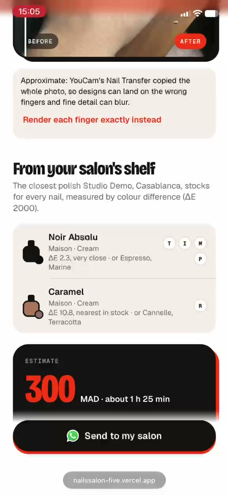
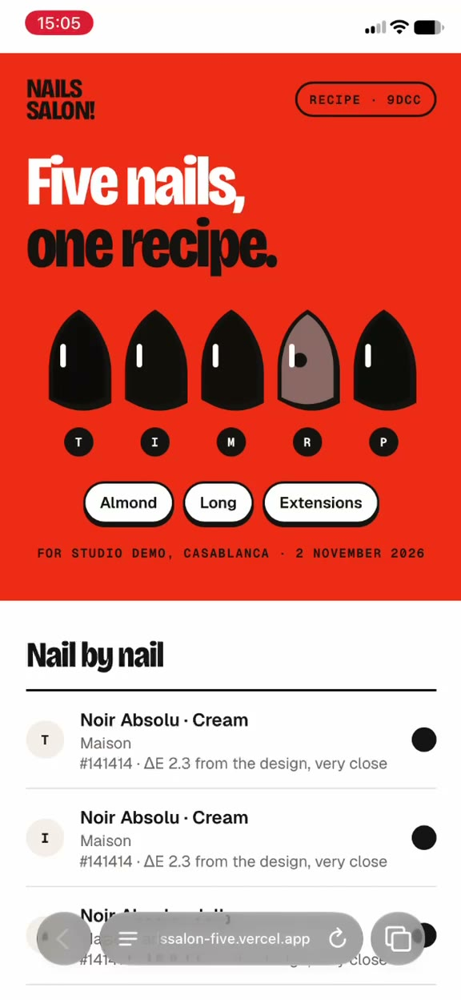

# NailsSalon

**Try before you paint.** Snap your hand, pick any nail photo, see it painted on your own hand, then send the recipe to your salon.

Built for the [YouCam API Skin AI & eCommerce VTO Hackathon](https://youcam-api-skin-ai-ecommerce.devpost.com/) on the **YouCam AI Nail Virtual Try-On** and **AI Nail Transfer** APIs.

- **Live app:** https://nailssalon-five.vercel.app (open it on a phone)
- **Demo video:** see the Devpost submission
- **Submission text and testing instructions:** [docs/SUBMISSION.md](docs/SUBMISSION.md)

## The problem

Every nail tech knows this message: a blurry screenshot, "can you do this?", and twenty minutes of guessing which colour, which finish, how long and how much. NailsSalon turns that screenshot into an exact, per-finger recipe, shows it on the client's own hand first, and matches it to the polishes the salon actually stocks.

## What it does

| Step | What happens | Where |
|---|---|---|
| 1. Hand photo | A hand-tracking model checks the shot live (one hand, back of the hand, flat, all five nails, sharp, well lit, nails not washed out) and takes the picture itself when everything holds. Nothing is uploaded and no API unit is spent until the photo will render well. | Browser, MediaPipe |
| 2. Inspiration | Any nail photo: screenshot, Instagram, Pinterest, camera roll. The app finds the five nails, outlines each one on the device (MobileSAM) and reads every nail separately: base colour, accents, finish, pattern, shape and length. The result is an editable **per-finger spec**, not a picture to copy. | Browser + Claude |
| 3. Edit | Change a colour, keep the art on some nails and only the colour on others, switch to extensions, pick a tip shape and length. | Browser |
| 4. Render | The spec goes to the **YouCam AI Nail Virtual Try-On API** in one call: every finger with its own colour, finish and artwork, on the client's real hand. When a design is too complex to read with confidence the app says so and uses the **YouCam AI Nail Transfer API** instead, labelled as approximate. | Server |
| 5. Salon shelf | Every nail is matched to the salon's polishes by colour difference (CIEDE2000, the number is shown), and the client gets a price and chair time from the salon's own price list. | Server, 0 units |
| 6. Recipe | One tap opens WhatsApp with a recipe link. The recipe card shows the look nail by nail: polish, finish, shape, length, the hand render and the price. | Server |

<p>







</p>

## YouCam APIs used

| API | Role in the app |
|---|---|
| **AI Nail Virtual Try-On** (`nail-vto`) | Main renderer. One task per look: five fingers, each driven from the compiled spec (hex colour, finish parameters, per-finger design PNG, press-on shape and length). |
| **AI Nail Transfer** (`ai-nail`) | Fallback and comparison. Used when the design reading is below the confidence threshold, or when the user asks to compare; results are labelled approximate. |

The API key never leaves the server. Every render is cached by hand photo and spec, so an identical request never spends a second unit, and a unit ledger enforces per-phone (15 per 24 h) and global caps.

## How it works

```
Browser                                   Server (Next.js on Vercel)                 Services
──────────────────────────────────────    ───────────────────────────────────────    ──────────────
Hand quality gate (MediaPipe, free)  ──►  POST /api/hands                             Supabase Storage
Nail outlines (MobileSAM, ONNX)      ──►  POST /api/designs/locate, /extract     ──►  Claude (reading)
Per-finger spec editor               ──►  POST /api/renders  → router → cache    ──►  YouCam Nail VTO
Before/after compare, polling        ◄──  GET  /api/renders/:id (post-processing)      or Nail Transfer
Salon shelf + estimate               ◄──  POST /api/quote (CIEDE2000, price rules)    Supabase Postgres
WhatsApp hand-off                    ◄──  POST /api/recipes → /r/:id (OG image)
```

Pieces worth a look:

- [`src/lib/hand-gate/`](src/lib/hand-gate): the live checks (pose from landmark geometry, sharpness, exposure, per-nail clipping) and the auto-capture.
- [`src/lib/inspo/`](src/lib/inspo): tap-to-pick and MobileSAM outlining in a worker, OKLab k-means colours, per-finger design PNG generation sized to Nail VTO's limits.
- [`src/lib/vision/`](src/lib/vision): the Claude reading (finish, pattern, shape, length per nail) with structured outputs.
- [`src/lib/spec/`](src/lib/spec): the `DesignSpec` type and the pure `toNailVtoPayload` function, unit-tested against the documented schema.
- [`src/lib/render/`](src/lib/render): the router between the two YouCam engines, the cache key, the true-colour composite and the realism pass applied to Nail VTO results.
- [`src/lib/shade/`](src/lib/shade): CIELAB conversion and CIEDE2000 matching against the salon's catalogue.
- [`docs/ARCHITECTURE.md`](docs/ARCHITECTURE.md): the full design, and [`docs/PROGRESS.md`](docs/PROGRESS.md): the day-by-day build log with every test result and unit spent.

## Tech stack

Next.js 16 (App Router, TypeScript, Cache Components) · React 19 · Tailwind CSS 4 · Supabase (Postgres, Storage) · MediaPipe Hand Landmarker (WASM) · MobileSAM on onnxruntime-web · Claude Sonnet 5.5 (vision) · sharp · zod · Vitest · Vercel

## Running locally

Requirements: Node.js 20.9+ (developed on Node 24), a Supabase project, a YouCam API key and an Anthropic API key.

```bash
git clone https://github.com/laafou98/nailssalon.git
cd nailssalon
npm install
cp .env.example .env.local   # then fill in the keys
```

Apply the database schema: run the SQL files in [`supabase/migrations/`](supabase/migrations) in order (Supabase dashboard → SQL Editor, or `supabase db push` with the Supabase CLI). Migration `0004` seeds the demo salon "Studio Demo" with its polishes and price list.

```bash
npm run dev          # http://localhost:3000
npm test             # unit tests (Vitest)
npm run typecheck
npm run lint
```

Free end-to-end testing without spending YouCam units or Claude credit:

```bash
YOUCAM_MOCK=1 VISION_MOCK=1 npm run dev
```

`GET /api/health` reports database connectivity and which server keys are configured. It never spends units.

### Environment variables

| Variable | Where it's used |
|---|---|
| `YOUCAM_API_KEY` | Server only. YouCam task APIs. |
| `ANTHROPIC_API_KEY` | Server only. Claude reads finish, pattern, shape and length from inspiration photos. |
| `VISION_MODEL` | Optional. Defaults to `claude-sonnet-5-5`. |
| `NEXT_PUBLIC_SUPABASE_URL` | Supabase project URL. |
| `NEXT_PUBLIC_SUPABASE_PUBLISHABLE_KEY` | Supabase publishable key (browser-safe). |
| `SUPABASE_SECRET_KEY` | Server only. Service-role access for the pipeline tables. |
| `UNITS_SESSION_CAP`, `UNITS_GLOBAL_CAP` | Caps on YouCam unit spend per phone (rolling 24 h) and in total. |
| `YOUCAM_MOCK`, `VISION_MOCK` | Local only. Fake renders and readings; ignored in production builds. |

### Scripts

- `scripts/smoke-test.mjs`: one Nail VTO and one Nail Transfer task against YouCam's sample images (2 units), results in `test-output/`. Run with `node --env-file=.env.local scripts/smoke-test.mjs`.
- `scripts/copy-wasm.mjs`: copies the MediaPipe and onnxruntime WASM files into `public/` (runs before `dev` and `build`).
- `scripts/compare-vision/`: compares vision models on a set of inspiration photos.
- `video/`: the tooling that composed the captioned demo video.

## License

[MIT](LICENSE)
